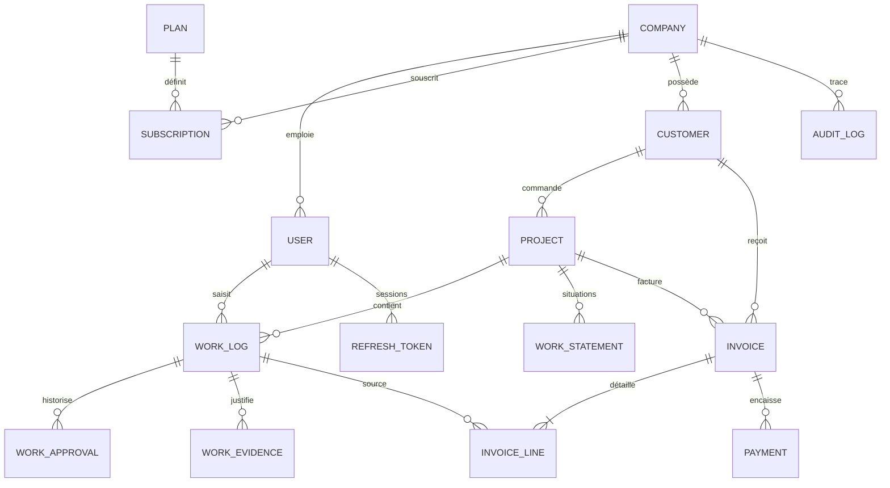

# Architecture MizanFlow

## Style : Modular Monolith
Un seul déployable Spring Boot, découpé par domaine (`auth, security, tenant, subscription, company, user, customer, project, worklog, invoice, audit, dashboard`). Chaque module : Entity → Repository → Service (+DTO `record`) → Controller. Les entités JPA ne sont jamais renvoyées par l'API. Choix justifié : une petite équipe, cohérence transactionnelle forte sur le financier, évolution possible vers des services si nécessaire.

## Multi-tenancy (base partagée, `tenant_id`)
1. Le JWT ne contient que l'identité ; `JwtAuthFilter` recharge l'utilisateur en base (actif ? entreprise active ? rôle ?) et pose le `TenantContext`.
2. Tous les accès : `findByIdAndTenantId`, `findByTenantId`. Aucun `tenantId` n'est lu depuis une requête.
3. `TenantEntity` refuse l'écriture si le tenant de l'entité ≠ tenant du contexte.
4. SQL : clés étrangères composites `(id, tenant_id)` → impossible de lier un projet d'une entreprise au client d'une autre, même par bug applicatif.
5. Limite connue : pas de Row-Level Security PostgreSQL (amélioration recommandée).

## Machine à états
- Prestation : `DRAFT → SUBMITTED → APPROVED | REJECTED(→SUBMITTED) ; APPROVED → INVOICED` (terminal). Chaque transition écrit `work_approvals` + `audit_logs`.
- Facture : `DRAFT → ISSUED → PARTIALLY_PAID → PAID` ; `CANCELLED` si aucun encaissement. `OVERDUE` est **dérivé** (échéance dépassée et solde > 0), jamais stocké.
- Anti double facturation : verrou pessimiste sur les prestations + `CHECK (invoiced_quantity <= quantity)`.
- Paiements : verrou de ligne sur la facture, refus des dépassements du solde, `PAID` uniquement à solde exactement nul. Montants en `BigDecimal` / `NUMERIC(14,2)`, arrondi HALF_UP.

## MCD (Mermaid)

Le MLD complet (types, contraintes, index) = `backend/src/main/resources/db/migration/V1__core_schema.sql`.
Tables déjà créées mais sans code applicatif : suppliers, quotations(+lines), work_statements(+lines), expenses, materials, stock_movements, notifications, automation_rules/executions, documents, work_evidence.

## API (préfixe `/api/v1`, OpenAPI : `/swagger-ui.html`)
| Méthode | Route | Rôles |
|---|---|---|
| POST | /auth/register · /auth/login · /auth/refresh · /auth/logout | public (rate-limited) |
| GET/POST/PUT | /customers, /customers/{id} | ADMIN, PM, ACCOUNTANT |
| GET/POST/PUT | /projects, /projects/{id} | lecture : ADMIN, PM, ACC, FIELD ; écriture : ADMIN, PM |
| GET/POST/PUT | /work-logs · POST /{id}/submit | ADMIN, PM, FIELD |
| POST | /work-logs/{id}/approve · /reject (motif obligatoire) | ADMIN, PM |
| GET/POST | /invoices, /invoices/from-work-logs · POST /{id}/issue · /cancel · /payments | ADMIN, ACCOUNTANT |
| GET | /payments · /dashboard | ADMIN, ACC (dashboard + PM) |
Erreurs : JSON `{timestamp,status,code,message,fields}` ; 402 quota, 403, 404 (aussi pour ressource d'un autre tenant), 422 règle métier, 429.
